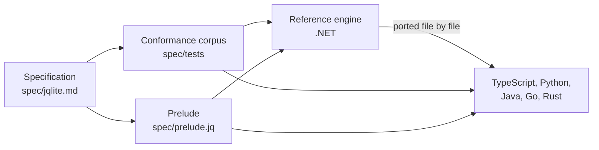

# The project

jqlite is one language with several implementations that must not drift apart. The repository is organized so that they cannot: the behaviour is written down once, tested once, and every implementation runs the same tests.

## How the parts fit

| Part | Where | What it is |
| --- | --- | --- |
| The specification | [`spec/jqlite.md`](../language/spec.md) | The language: grammar, values, semantics, builtins, errors, limits, the host interface, and the differences from jq. It is normative. |
| The prelude | [`spec/prelude.jq`](https://github.com/devlooped/jqlite/blob/main/spec/prelude.jq) | The builtins that are written in jqlite itself. Every implementation embeds this file unchanged. |
| The conformance corpus | [`spec/tests`](corpus.md) | The cases every implementation must pass: a program, an input, the expected outputs. The expected outputs are what jq 1.8.2 prints, except where the specification lists a difference. |
| The reference | [`dotnet/JQLite/Core`](https://github.com/devlooped/jqlite/tree/main/dotnet/JQLite/Core) | The engine, in C#, written without anything that another language lacks: no host JSON library, no iterators, no reflection, no exceptions as control flow. |
| The ports | [`go`](https://github.com/devlooped/jqlite/tree/main/go), [`java`](https://github.com/devlooped/jqlite/tree/main/java), [`python`](https://github.com/devlooped/jqlite/tree/main/python), [`rust`](https://github.com/devlooped/jqlite/tree/main/rust), [`typescript`](https://github.com/devlooped/jqlite/tree/main/typescript) | The same engine, file by file, each with a host API in the idiom of its language. |

A change of behaviour goes through them in that order: the specification first, then a case in the corpus, then the reference, then every port. A port that lags fails the new cases.

## In this section

| Page | What it is |
| --- | --- |
| [Porting guide](porting.md) | How the reference is built, layer by layer, and how each shape of it carries over to another language. |
| [Conformance corpus](corpus.md) | The format of the test files and how a case is run. |
| [Benchmarks](benchmarks.md) | The cross-language benchmark: the cases, the runner of each implementation, how to run it. |

## Contributing

The source, the issues and the discussions are on [GitHub](https://github.com/devlooped/jqlite). The repository's [`AGENTS.md`](https://github.com/devlooped/jqlite/blob/main/AGENTS.md) says where each kind of change goes and which rules the engine's code follows.

jqlite is under the [MIT license](https://github.com/devlooped/jqlite/blob/main/license.txt), and its use is subject to the [Open Source Maintenance Fee EULA](https://github.com/devlooped/jqlite/blob/main/osmfeula.txt).
